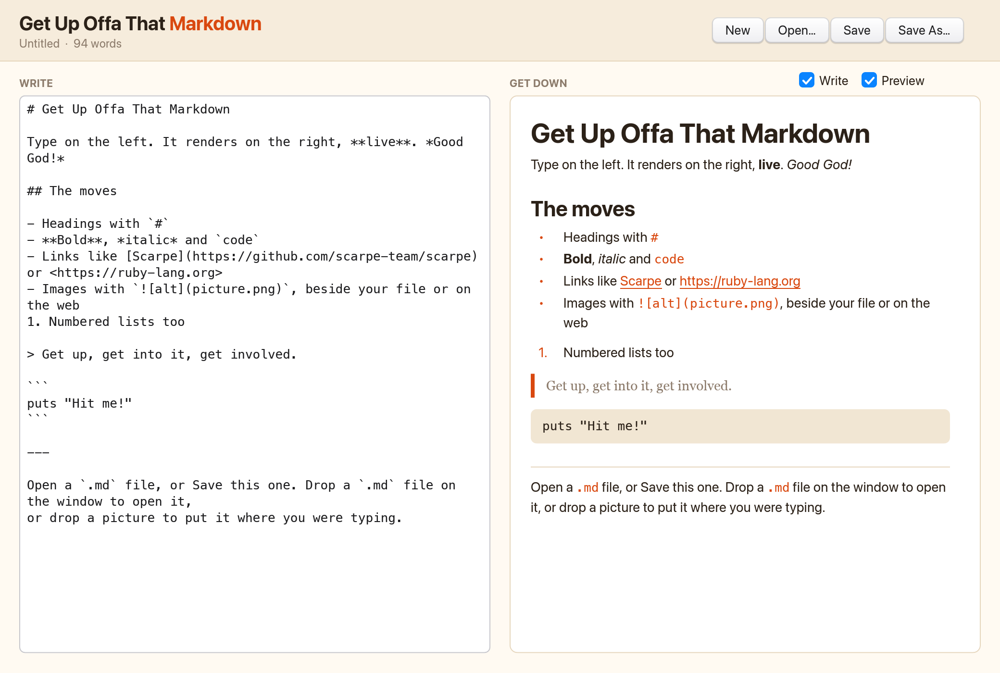

# Get Up Offa That Markdown

*Get up, get into it, get involved.* A small Markdown editor for the Mac: you type on the
left, and the rendered page updates on the right as you go. It's written in about 400 lines of
Ruby with [Scarpe](https://github.com/scarpe-team/scarpe), which runs
[Shoes](https://github.com/shoes/shoes-deprecated) apps on a native Rust renderer.



**Website:** https://markdown.codenamev.com/

## What it does

- Renders headings, paragraphs, **bold**, *italic*, `code`, links, bullet and numbered lists,
  quotes, code blocks, horizontal rules and images (from local files or the web).
- Lets you hide either pane, so you can show just the Markdown or just the preview, and the
  window can be resized.
- Opens, saves and starts new `.md` files.
- Saves a draft as you type, so your work survives quitting.
- Opens a `.md` file that you drag onto the window, or open with it from Finder (**Open With**).
  Drag in a picture or any other file, and an image or link to it goes in where you were typing.
- Opens a link to another `.md` file in the editor. Web links open in your browser.
- Underlines misspelled prose in red using offline [Kotoshu](https://github.com/kotoshu/kotoshu) and bundled American English. Markdown code and URL/email targets are excluded.
- Autocorrects newly completed words after a short pause. Only the first suggestion is considered, and it must be exactly one edit away and accepted by the dictionary. Lowercase/title case is preserved; ALL CAPS, mixed case, dotted names, and identifier-like tokens stay report-only. Turn off **Autocorrect** to keep underlines without replacements; Cmd-Z undoes a correction.

## Install

1. Download `Get-Up-Offa-That-Markdown-1.1.0-arm64.dmg` from the
   [latest release](https://github.com/codenamev/get-up-offa-that-markdown/releases/latest).
2. Open it and drag the app into **Applications**.
3. The first time, macOS will block it, because the app isn't notarised by Apple. Open it once
   and close the warning, then choose **Open Anyway** in **System Settings → Privacy &
   Security**. Or run this in Terminal:

   ```sh
   xattr -dr com.apple.quarantine "/Applications/Get Up Offa That Markdown.app"
   ```

It needs a Mac with Apple silicon (M1 or later). Ruby and everything else the app uses are
bundled inside it, so you don't need to install anything.

## Run it from source

This needs Ruby 3.2.11 or newer and Rust 1.89 or newer. The Gemfile pins [codenamev/scarpe#1](https://github.com/codenamev/scarpe/pull/1) at `0fa039c4`, providing spelling underlines and undo-safe replacements on top of the `native/drop-files` branch ([scarpe-team/scarpe#648](https://github.com/scarpe-team/scarpe/pull/648)). Bundler installs all three Scarpe components from the same revision; a separate clone is not needed.

```sh
git clone https://github.com/codenamev/get-up-offa-that-markdown.git
cd get-up-offa-that-markdown
gem install bundler -v 2.4.10
bundle install
bundle exec scarpe --native "$PWD/get_down.rb"
```

The first run builds Scarpe's renderer, which takes about a minute.

Opening a file only checks it; autocorrection starts with newly typed/pasted text, not existing file contents. The word still being typed is never corrected.

If Ruby 3.3 headers fail Nokogiri's feature probes with Xcode 26/Clang 21, install with `BUNDLE_BUILD__NOKOGIRI='--with-cflags=-Wno-default-const-init-field-unsafe' bundle install` instead. This flag applies only to that installation command.

### Developing

`./scarpe.sh` runs the pinned Scarpe dependency (or `$SCARPE` for a source checkout override) without touching your clipboard, sounds or real home folder. To render the app headless and save a picture of it:

```sh
./scarpe.sh peek get_down.rb --scale 2 --shot shots/look.png --layout
```

Run spelling checks with `bundle exec ruby test/spelling_test.rb`. The bundled dictionary's license and pinned provenance are in [data/en](data/en/README.md).

### Packaging

The existing release does not include spellchecking. The development build now needs Kotoshu and Commonmarker; Scarpe's stock packager does not collect these extra gems. The packaging recipe below must not be used to distribute this development build until those dependencies are bundled.

From the Scarpe clone:

```sh
./scarpe.sh peek icon/icon.rb --shot icon/square.png        # in this folder: draw the icon
magick icon/square.png \( -size 1024x1024 xc:none -fill white \
  -draw "roundrectangle 100,100 923,923 185,185" \) -compose DstIn -composite icon/icon.png

cd ~/scarpe && bundle exec ruby exe/scarpe package /path/to/get_down.rb --native --dmg \
  --name "Get Up Offa That Markdown" --icon /path/to/icon/icon.png --output /path/to/dist \
  --opens net.daringfireball.markdown --opens public.plain-text --opens md --opens markdown \
  --app-version 1.1.0
```

`--opens` is what lets Finder offer the app under **Open With** for Markdown and text files.
`--app-version` sets the version Finder's Get Info shows. It comes from
[scarpe-team/scarpe#651](https://github.com/scarpe-team/scarpe/pull/651); until that's merged,
leave it out, or build from a branch that also has that commit.

## Credits

Built on [Scarpe](https://github.com/scarpe-team/scarpe) and _why's Shoes. The name is a nod
to James Brown's "Get Up Offa That Thing".

## License

[MIT](LICENSE)
